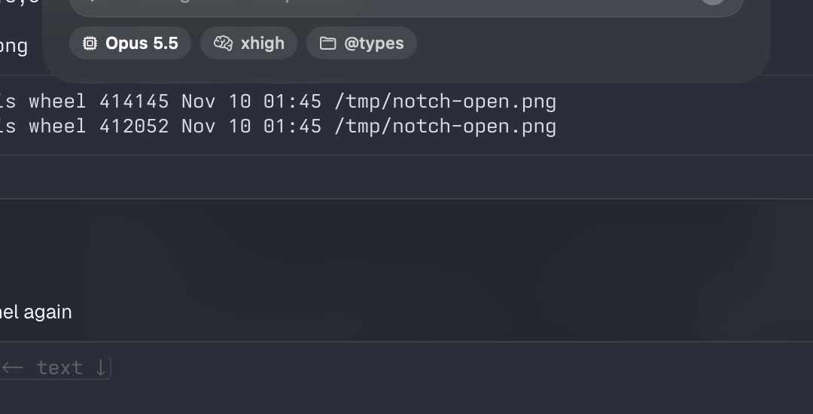

# tern-notch

Your Tern agents in the MacBook notch.



- Activity bars while an agent works, a blinking dot when it asks a question.
- Hover to open: answer questions, send messages, run slash commands with autocomplete.
- Switch model and thinking effort; see the branch and diff.
- **+ New** starts an omp agent in a new Tern tab.
- Settings from the gear or a right click on the notch.

## Install

Needs macOS 14+ and the Xcode Command Line Tools.

```sh
tern plugin install github.com/EternityX/tern-notch
```

The plugin builds and starts the notch helper on first load. After editing
`app/Sources`, run `./build.sh` and **Agent Notch: restart helper**.

Quit other notch apps (NotchNook and the like) while this one runs.
